# Lumi

A Dynamic Island for Windows. Lumi is a black notch that hugs the top edge of your screen, morphs to show what's going on, and opens into a dashboard of small apps when you hover over it.

**Website and download: [lumi-theta-woad.vercel.app](https://lumi-theta-woad.vercel.app)**

<p align="center">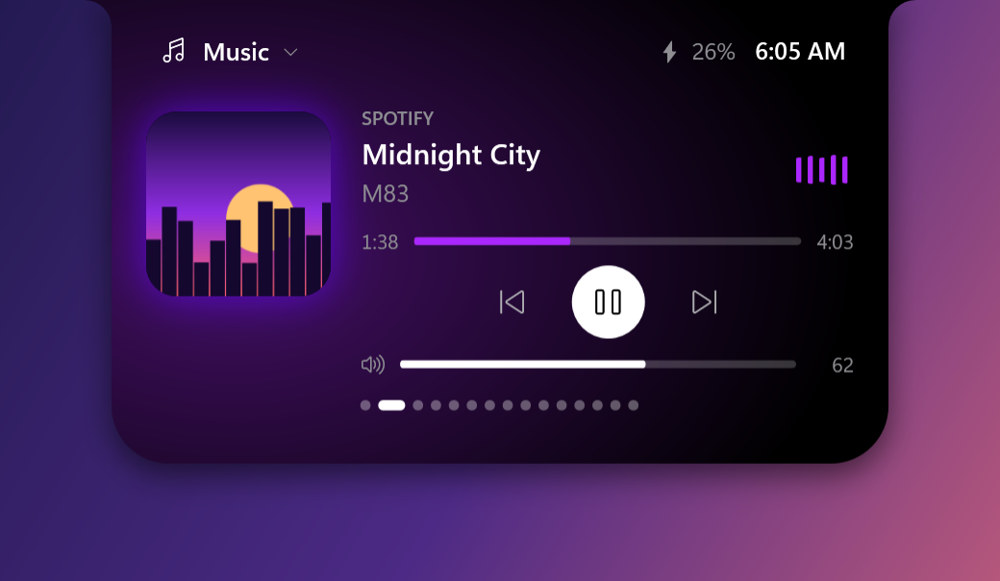</p>

**At rest, the notch shows what matters right now:**

<p align="center">
  
  
  
</p>

**...and opens briefly for things worth a glance:**

<p align="center">
  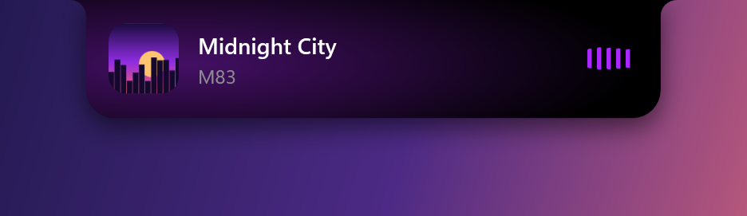
  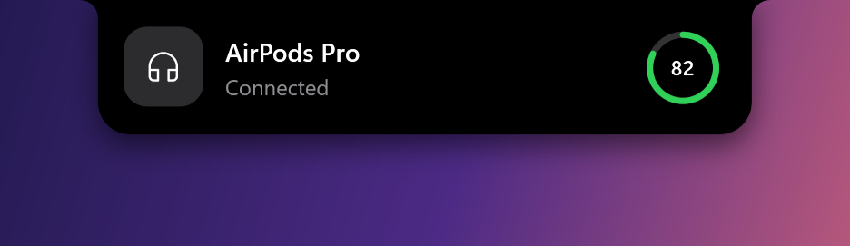
  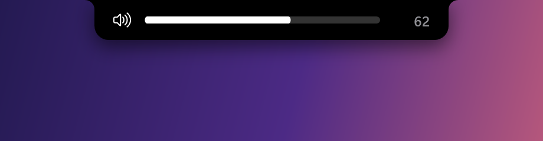
</p>

| | |
|---|---|
| 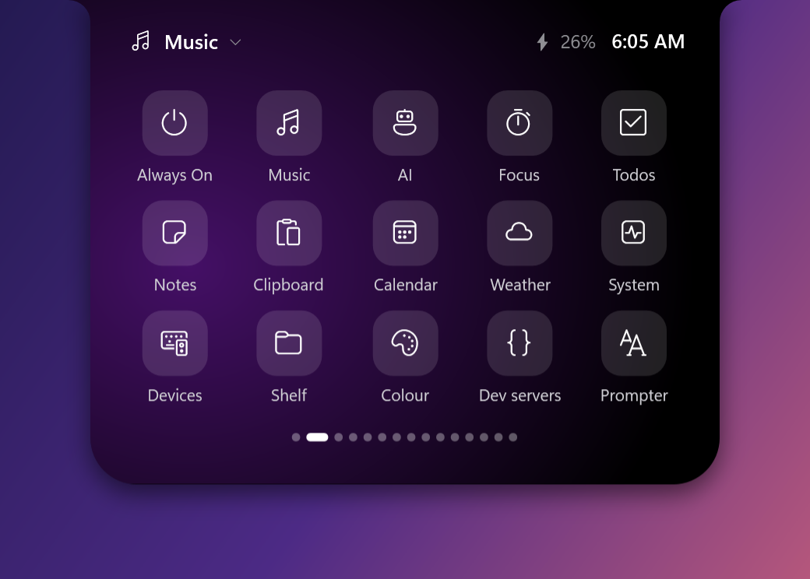 | 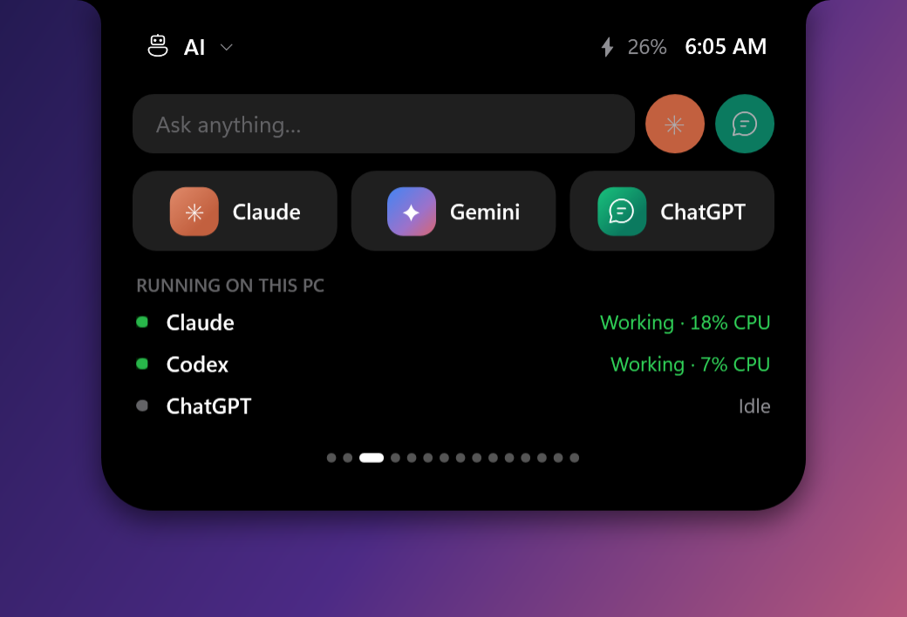 |
| 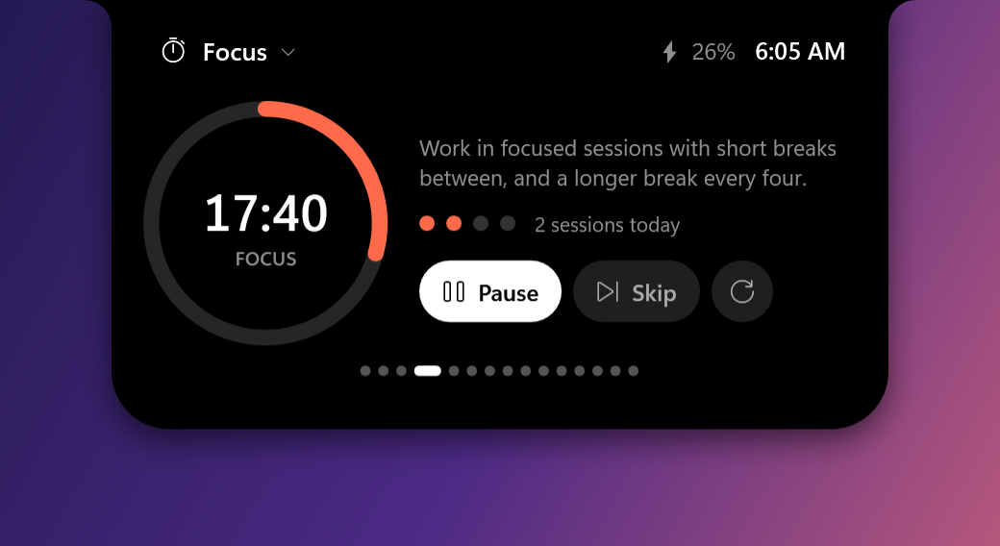 | 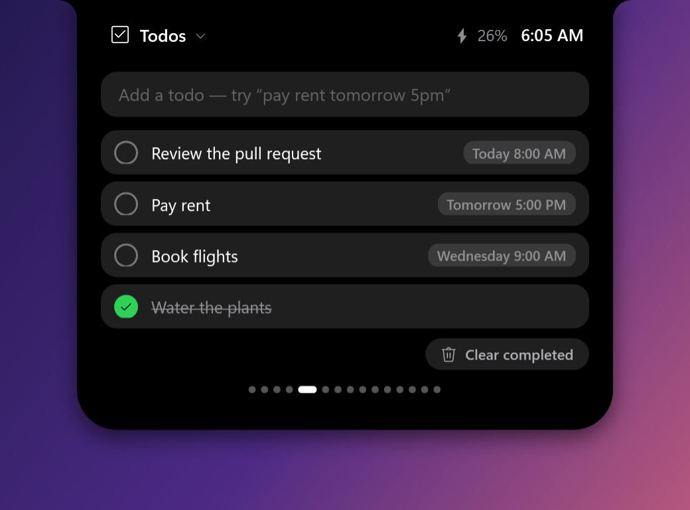 |
| 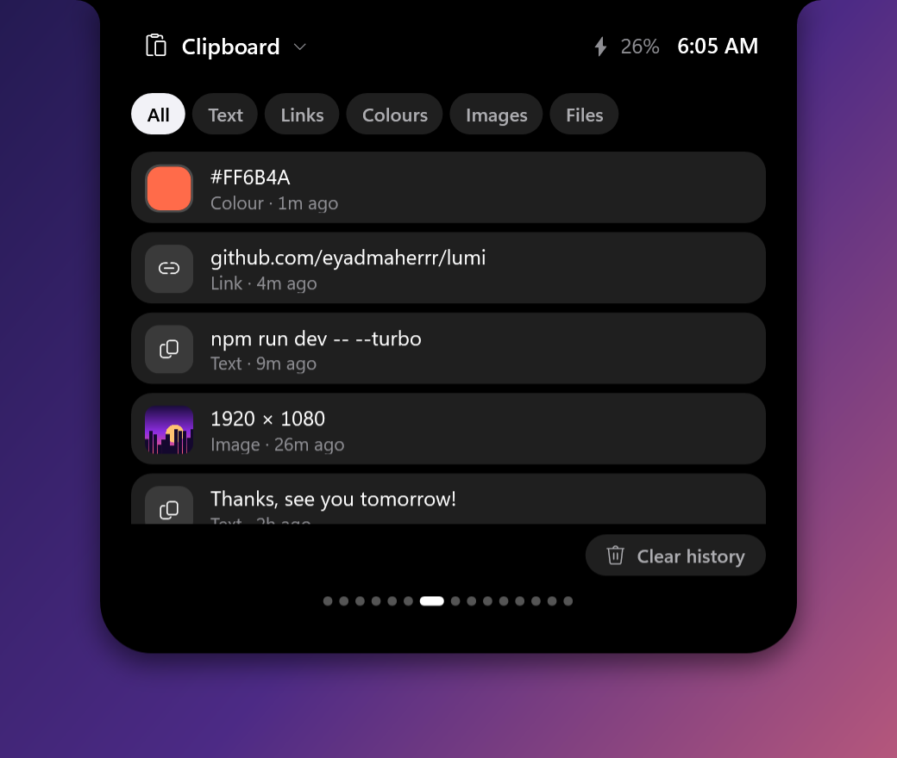 | 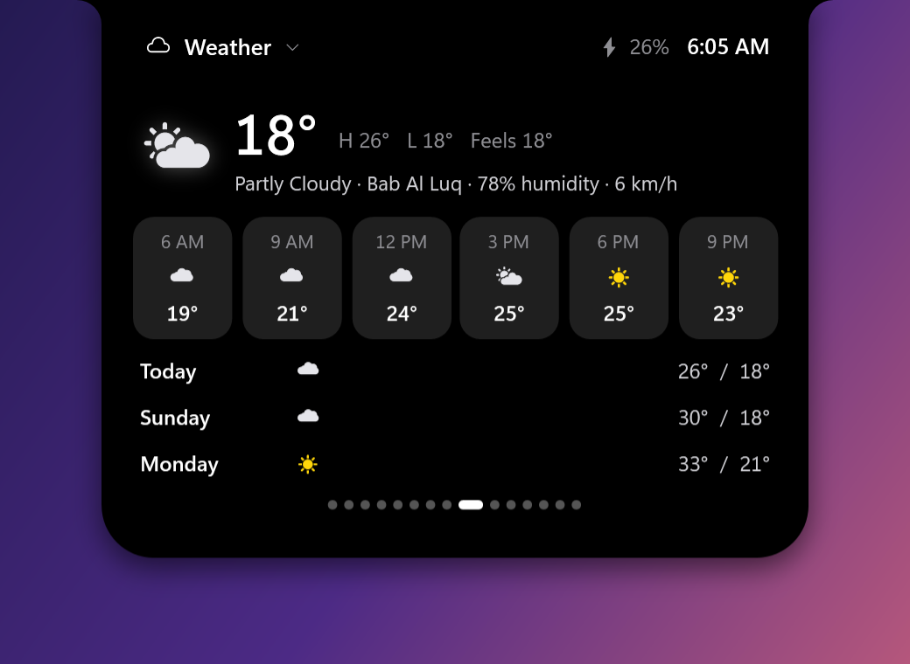 |
| 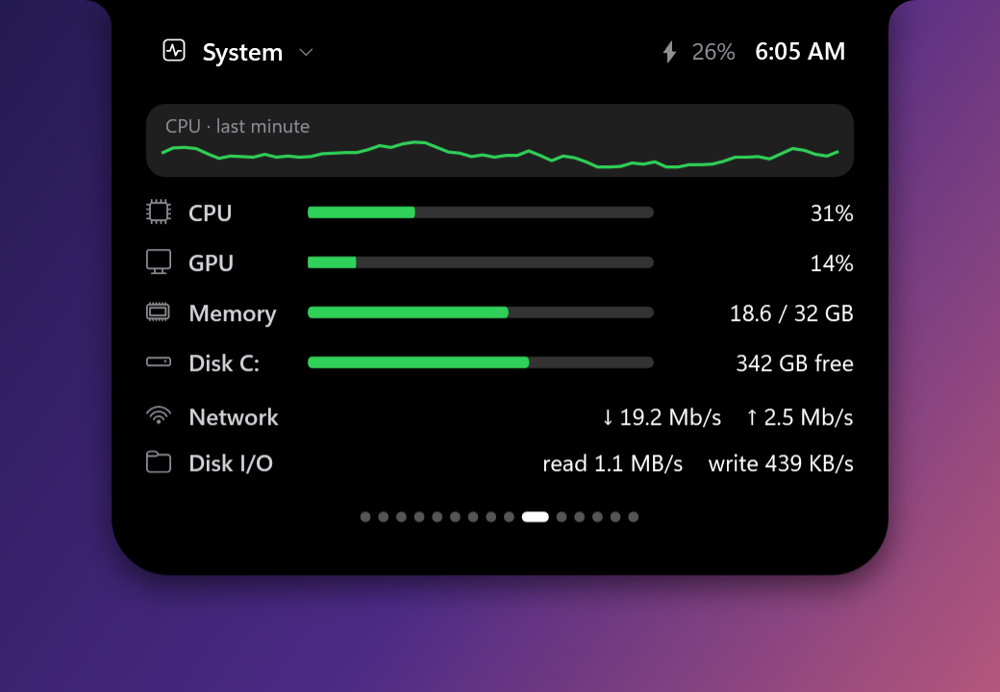 | 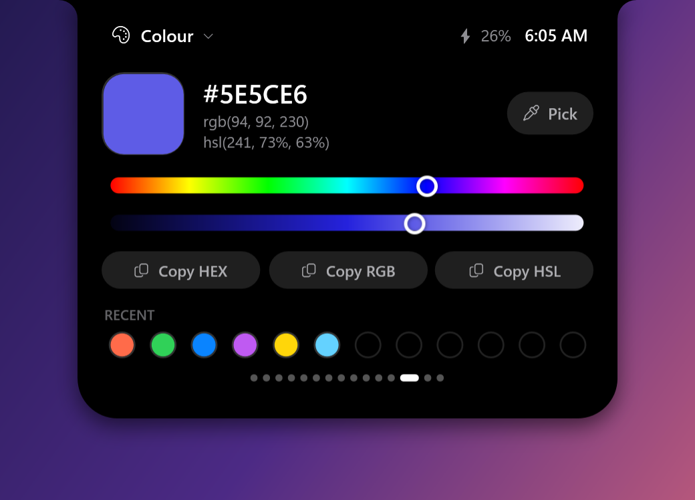 |
| 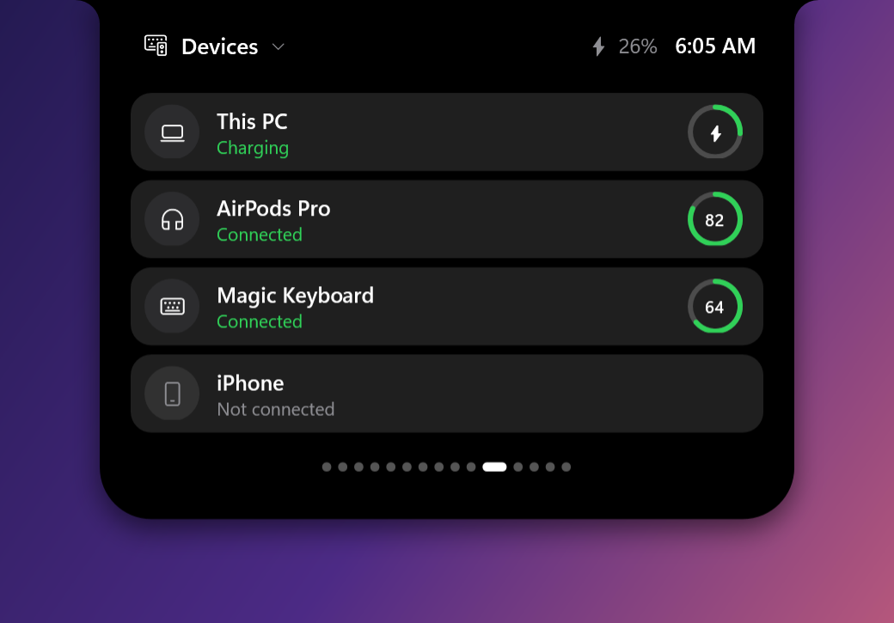 | 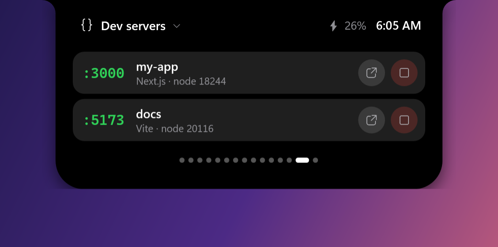 |

<sub>Images are rendered by `Lumi.exe --screenshots docs/images` with made-up sample data.</sub>

## What it does

**In the notch** (the resting pill shows the most important thing, in this order):
- **Teleprompter**: your script, one line at a time, right under the camera
- **Focus timer**: a progress ring and the time left
- **Downloads**: speed and size while a browser download runs
- **Now playing**: album art and a waveform that follows the real audio level, tinted with the cover's colour
- **Always On**: keeps the PC awake (for long-running AI agents and builds), with a timer

**Pop-ups**: song changes, AirPods and other headphones connecting (with a battery ring), volume and brightness (a slider you can drag), copied text, links, colours, images and verification codes, Windows notifications, todo reminders, finished downloads. A green dot shows while an app uses the camera.

**Apps in the open island** (click the title for all of them, scroll or swipe sideways to flip):

| App | |
|---|---|
| Always On | Keep the PC awake forever or for 30 min to 8 h, screen on or off, start with Windows |
| Music | Any app that plays (Spotify, YouTube, Apple Music, VLC…): artwork, scrubbing, controls, volume |
| AI | Ask Claude or ChatGPT straight from the notch; see which AI apps and CLIs are running and working |
| Focus | Focus sessions with short breaks and a long break every four |
| Todos | "pay rent tomorrow 5pm" understood, with reminders |
| Notes | Pinned notes, click to copy; saved on this PC |
| Clipboard | History with colour swatches, image thumbnails and clean links; filter by type, click to copy again |
| Calendar | Month view with today and your todos |
| Weather | Now, the next hours and the next days |
| System | CPU history, CPU, GPU, memory, disk, network and disk I/O |
| Devices | Bluetooth devices and this PC, with batteries |
| Shelf | Drop files on the island to keep them handy; finished downloads land here too |
| Colour | Pick any colour off the screen; copy as HEX, RGB or HSL; recent colours |
| Dev servers | Local servers (Next.js, Vite, Python…) with their port; open or stop them |
| Prompter | The teleprompter controls and reading speed |

**Gestures**: hover to peek, scroll down on the notch to open it, scroll or swipe sideways to switch apps, click an empty spot to pin the island open. Right-click for themes, transparency, notch or floating-pill shape, which screen, and which pop-ups you want. **Ctrl+Alt+D** hides or shows the island.

## Install

Download `LumiSetup.exe` from the [website](https://lumi-theta-woad.vercel.app) (or the [latest release](../../releases/latest)) and run it. It installs for your user only (no admin needed) into `%LOCALAPPDATA%\Programs\Lumi`, adds a Start menu shortcut, and appears in **Settings > Apps** so you can uninstall it like any other app.

- Silent install: `LumiSetup.exe /S`
- Uninstall from Settings > Apps, or `"%LOCALAPPDATA%\Programs\Lumi\Uninstall Lumi.exe" /uninstall` (add `/S` for no prompts). Your notes, todos and settings in `%APPDATA%\Lumi` are kept unless you choose to delete them.

Requires Windows 10 (1809+) or 11. Lumi uses the .NET Framework that ships with Windows, so there's nothing else to install.

> **Smart App Control:** releases are not yet code-signed, so Windows' Smart App Control may block them on PCs where it's turned on. Signing with Azure Trusted Signing is being set up (see below).

## Build

```powershell
powershell -ExecutionPolicy Bypass -File build.ps1
```

This compiles `dist\Lumi.exe` and `dist\LumiSetup.exe` (which carries Lumi.exe inside) using the C# compiler built into Windows. No Visual Studio or .NET SDK needed.

| Folder | |
|---|---|
| `src/` | The app: `Program.cs` (entry, Windows APIs, audio), `Island.cs` (the notch, views, gestures, menu, settings), `Pages.cs` and `Pages.Tools.cs` (the apps), `Services.cs` and `Services.Tools.cs` (media, notifications, stats, weather, Bluetooth, AI tools, dev servers, downloads), `Ui.cs` (shared controls and animation), `Screenshots.cs` (renders the README images) |
| `docs/images/` | README images. Regenerate with `dist\Lumi.exe --screenshots docs\images` |
| `site/` | The website (static HTML). `publish-site.ps1` copies the latest installer and images in and deploys it to Vercel |
| `installer/` | `Setup.cs`, the installer and uninstaller |
| `dist/` | Build output (not committed) |

### Code signing

`build.ps1` signs both exes with signtool when either:
- `signing.json` exists (copy `signing.example.json` and fill in your Azure Trusted Signing endpoint, account and certificate profile, then `az login`), or
- you pass `-Pfx <file> [-PfxPassword <pw>]` or `-Thumbprint <hex>` for a certificate you already have.

Tools: `winget install Microsoft.Azure.ArtifactSigningClientTools` and `winget install Microsoft.AzureCLI`.

## Privacy

Everything stays on your PC except:
- **Weather** is fetched from [wttr.in](https://wttr.in), which picks your location from your IP address.
- **Ask AI** and the app links open claude.ai, chatgpt.com or gemini.google.com in your browser, only when you use them.

Clipboard history is kept in memory only and is gone when Lumi quits; anything a password manager marks as secret is skipped. Notifications are read only to show them as pop-ups (Windows asks for permission). Notes, todos, colours and settings are saved in `%APPDATA%\Lumi`.
